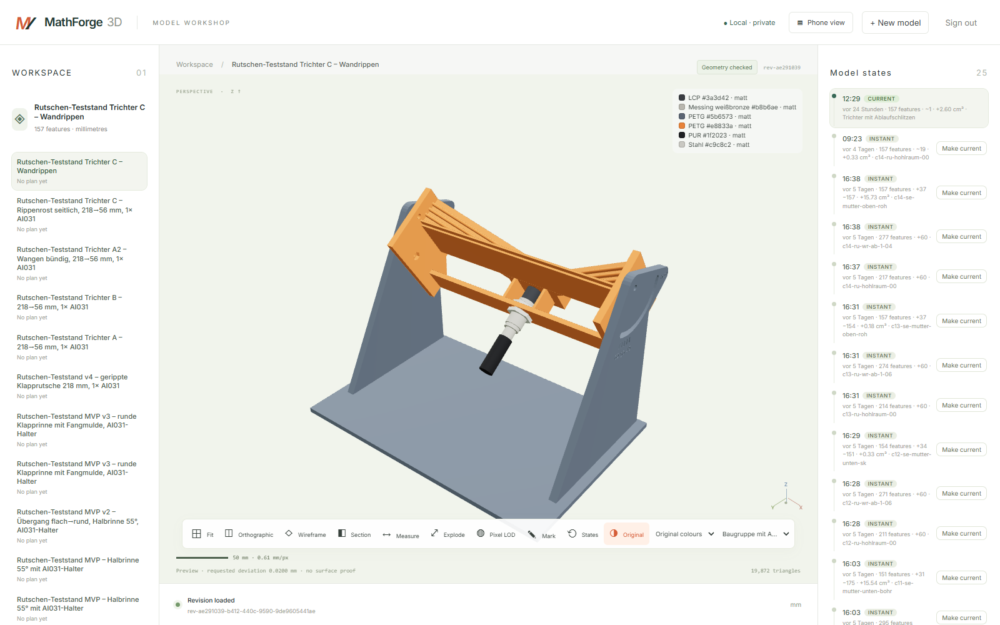
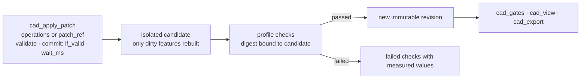
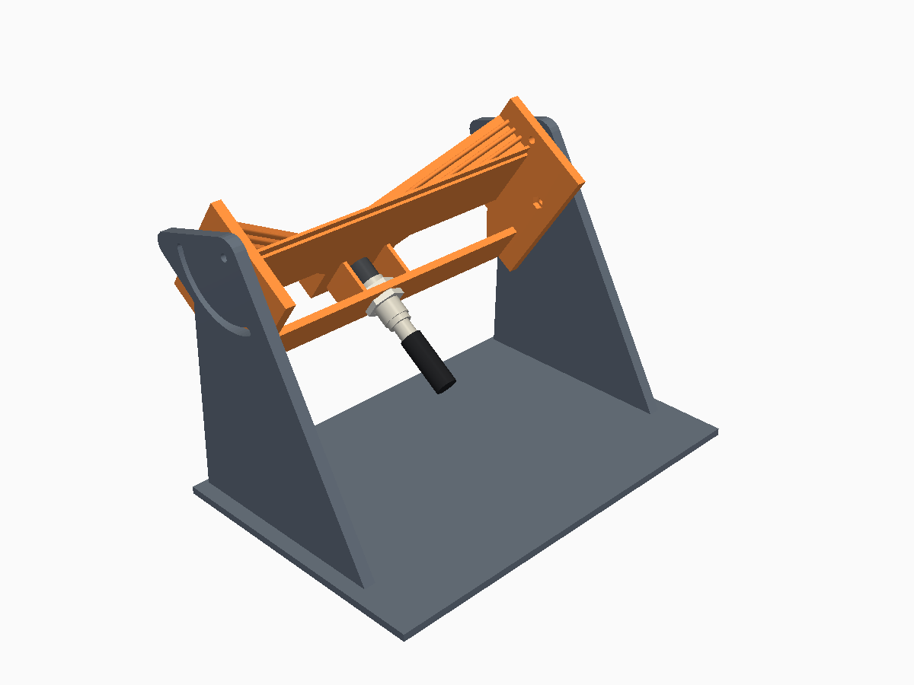

# LLcad

**A mathematics-first CAD server for MCP clients, running natively on Windows.** Your agent
describes parts and assemblies in plain language; LLcad turns them into versioned parametric
constructions on a real Open CASCADE kernel, checks every change and only then commits it. A
browser viewer is optional and can be opened and closed by the agent itself.

No WSL, no administrator rights, no background service: the server starts on the first CAD
tool call and exits by itself when it has been idle.



## Why

- **Real geometry, not pictures.** Boxes, cylinders, sketches with true arcs and corner radii,
  extrusions, revolves, sweeps, lofts, booleans, holes, fillets, drafts, threads, patterns,
  one-feature text and ring text, SVG emblems, implicit fields, NURBS and measured B-Rep facts,
  all computed by Open CASCADE in an isolated worker process.
- **Every change is verified.** A change is computed as an isolated candidate, validated against
  a precision profile and committed atomically with a server-generated digest. Old revisions
  never change.
- **Checked against the real product.** Reference photos are registered to absolute cameras, and
  a deterministic gate pack measures silhouettes, landmarks, colours, control visibility,
  contacts and coincident faces in millimetres and ΔE, not in model opinions.
- **Made for agents.** 40 typed tools with strict input and output schemas, one-call
  apply-validate-commit transactions, server-side waits instead of polling, patches submitted
  by file reference, compact answers and actionable errors. Operator semantics, pitfalls and
  examples are served as MCP resources.
- **Technical drawings (work in progress).** A rule-based planner derives views, sections,
  ISO 129 dimensions, parts list and title block from the B-rep and renders checked PDF sheets.
- **Idle means idle.** Claude Code only starts a small stdio bridge (about 55 MB, no CPU). It
  answers the tool lists from a cache, starts the server on demand and lets it exit after
  15 minutes without requests.

## Quick start

Requirements: Windows 10 (1809 or later) or 11 on x86-64, Windows PowerShell 5.1, `curl.exe` and
`tar.exe` (both ship with Windows), about 6 GB of free disk space and no administrator rights.
Everything else is downloaded by the installer and checked against SHA-256.

```powershell
mkdir C:\llcad; cd C:\llcad
git clone https://github.com/Tends2o/LLcad.git
cd LLcad
powershell -NoProfile -ExecutionPolicy Bypass -File install.ps1
```

Without `git`, download the repository as ZIP from GitHub, extract it to `C:\llcad\LLcad`, run
`Get-ChildItem -Recurse C:\llcad\LLcad | Unblock-File` once and then the installer.

The installer asks before large optional downloads and explains what happens if you decline.
If Claude Code is missing, it offers to install it with the official installer. When it has
finished, restart Claude Code; `/mcp` shows `llcad` as connected. A first prompt:

> Create a 90 × 60 mm circuit board, 1.6 mm thick, with four M3 mounting holes 4 mm from the
> corners, then open the viewer.

Notes:

- Paths must not contain spaces (the hook commands use plain paths).
- The parent folder of the clone (`C:\llcad` above) becomes the folder that `patch_ref` files
  and SVG logos may be read from (`LLCAD_PATCH_PATHS`). Keep your CAD projects there and clone
  into a dedicated folder, not directly under `C:\`.
- Options: `-SkipBuild` only rewrites the configuration, `-NoClaude` skips skill, memory and MCP
  entry, `-NoShortcut` skips the Start menu entry, `-DrawingModel ask|yes|no` and
  `-ClaudeCode ask|yes|no` answer the questions in advance, `-Port 4310` and `-IdleMinutes 15`
  change the defaults. `Get-Help .\install.ps1 -Detailed` lists them all.
- In a non-interactive session (for example when an agent runs the installer) nothing is
  asked: optional downloads are skipped and the installer prints how to add them later.

## What the installer sets up

| Component | Location |
|---|---|
| Node 24.19.0 (portable) | `tools\node` |
| Python 3.13 with Open CASCADE, VTK and NumPy (wheels via uv) | `LLcad\.venv` |
| Zig 0.16 (clang) as C++ compiler for the native mesh checker | `tools\zigenv` |
| CGAL 6.0.1, Boost 1.83 headers, GMP 6.3 / MPFR 4.2.1 | `tools\native` |
| DejaVu and Liberation fonts (Inter, Outfit, Cascadia Mono are in the repo) | `fonts\` |
| Chromium for viewer captures and reference review (Playwright) | `%LOCALAPPDATA%\ms-playwright` |
| Drawing tools: PDF rasterizer and RapidOCR (Python packages) | `LLcad\.venv` |
| RapidOCR models for the drawing legibility check (16 MB, Hugging Face) | `models\rapidocr` |
| Optional, asked first: local vision model MiniCPM-V 4.7 (15.4 GB, Hugging Face) and llama.cpp | `models\minicpm-v-4.7`, `tools\llama.cpp` |
| Local access token, data folder restricted to your user by ACL | `LLcad\data` |
| Drawing configuration (company lines, title block defaults, keyword lists) | `LLcad\data\drawing-config.json` |
| `llcad.env`, `llcad.cmd`, Start menu entry **LLcad Viewer** | package root |
| Claude Code skill `llcad-modelling` with its six hooks | `%USERPROFILE%\.claude\skills` |
| MCP entry `llcad` (user scope, stdio bridge) and the `mcp__llcad` permission | Claude Code |

The installer can be run again at any time; it reuses downloads and builds that are present and
resumes interrupted downloads. All pinned versions and checksums are in
`LLcad/deployment/native-packages.json` and `LLcad/deployment/drawing-models.json`.

## Repository layout

```
LLcad/                    repository root = the Windows package
├── install.ps1           installer (tools, build, drawing support, configuration, skill, MCP entry)
├── claude/
│   ├── skills/           Claude Code skill llcad-modelling: SKILL.md, references, Python DSL
│   │                     client and the hooks (lint, wait, gates, time signal, stop gate, ledger)
│   ├── memory/           a learned project rule that the installer copies into Claude's memory
│   └── mcp-examples/     MCP configuration examples (stdio bridge, HTTP)
├── fonts/                Inter, Outfit, Cascadia Mono (OFL) for text features
└── LLcad/                server source: MCP gateway, model service, compiler, validation,
                          reference review, drawing generator, viewer, Open CASCADE and CGAL workers
```

The installer adds `tools\`, `models\`, `llcad.env` and `llcad.cmd` next to these folders; they
are not part of the repository.

## Operation

```
llcad.cmd status | start | stop | viewer [model-id]
```

- **Viewer on request only:** ask Claude to open the viewer (`cad_viewer_open`), use the Start
  menu entry **LLcad Viewer** or run `llcad.cmd viewer`. While you work in the viewer or an AI
  run is active, the server stays awake; an untouched viewer tab does not keep it alive.
- **Logs:** `LLcad\data\logs\server.log`. For bridge diagnostics create an empty file
  `LLcad\data\logs\bridge-debug.on`; the bridge then writes `bridge-debug.log`.
- **Update:** `git pull`, then run `install.ps1` again (it stops the server and rebuilds).
- **Uninstall:** `claude mcp remove llcad -s user`, delete
  `%USERPROFILE%\.claude\skills\llcad-modelling` and the Start menu entry, remove the folder
  (it contains `tools\` and `models\`). Playwright's Chromium lives in `%LOCALAPPDATA%\ms-playwright`.

### Windows specifics

| Topic | Behaviour on Windows |
|---|---|
| Worker isolation | Separate process with a minimal environment in its work folder, a Job Object (1.5 GB memory limit, child processes die with it) and a CPU watchdog. There is **no file system or network isolation**, so only run patches you trust. |
| Data folder lock | Owner file `data\.store.owner` (PID); orphaned owners are taken over. |
| Permissions | ACL: only your user and SYSTEM. |
| Path lists (`LLCAD_PATCH_PATHS`, `LLCAD_FONT_DIRS`) | Separated by `;`. |
| Parallel subtree evaluation, parallel preview tessellation | Not available (serial). |
| OpenVDB (`vdb` import/export, VDB fields) | Not available (no Windows wheel); these features answer `OUT_OF_SCOPE`. |
| Python in the skill and hooks | Absolute path to the package venv with `-X utf8` (`python3` is only the Store placeholder on Windows). |

## How a change flows



The client never sends geometry; it sends typed operations with units, inline or as a patch
file. The server compiles them into a dependency graph, computes only the dirty features in an
isolated worker process, measures the result and binds the validation digest to the exact
candidate, kernel build and policy. A single `cad_apply_patch` call can apply, wait, validate
and commit; the separate `cad_plan_edit`, `cad_validate` and `cad_commit` steps remain available.

Models can carry settings (tolerance presets, including an explicit `visual_reconstruction`
preset), named variables, configurations for variants and states, decals, and macros for
recurring components such as knurled rings, lenses, keys, LED rows and USB-C receptacles.

## Looking at a revision

| | |
|---|---|
|  |  |

`cad_view` renders any revision offscreen (VTK) from preset or absolute cameras in three
channels: lit, albedo (flat declared colours) and ids (one colour per part). Every view comes
with a per-part table of visible pixels, bounding box, centroid and colour difference.

## Reference review

Reference images are bound to a model with `cad_reference_setup` and registered to absolute
cameras with `cad_reference_register`. `cad_gates` then returns a floor, never a verdict: a
ranked list of residuals such as silhouette IoU and chamfer in millimetres, landmark and marking
offsets, per-part colour difference in an unlit channel, hidden controls, floating parts and
coincident faces. An optional judge reviews what cannot be measured; its findings count only
when a measurement confirms them. Details are in [Reference review](LLcad/docs/reference-review.md).

## The viewer

The viewer is a read-mostly window into the same revisions: structure and feature tree,
parameters, measurements, section plane, wireframe, explosion, original and part colours,
configurations, decals, revision time travel and pixel-adaptive tessellation. Reference photos
can be overlaid on the model, shown side by side or compared against it. The viewer can also hand
a new model or a marked change to a local agent run and shows its progress and report.
`cad_viewer_open` starts it on demand, hands the browser a single-use login code and can
preselect a model; `cad_viewer_close` stops it again.

## Technical drawings (work in progress)

Drawing generation is under active development; its interfaces and results can still change.

`cad_drawing_analyze` measures a committed revision for drawing purposes (holes, shafts, gaps,
bends, view extents). `cad_drawing_plan` is a deterministic planner: from the geometry and optional
facts quoted from the model texts (materials, names, roles, tolerances) it proposes complete drawing
specifications with views, sections, detail views, ISO 129 dimensions, parts list and ISO 7200 title
block. `cad_drawing_render` renders a specification to PDF and PNG sheets and returns findings such
as overlaps, undimensioned features or texts on lines; `cad_drawing_publish` attaches a checked
render to its revision so the viewer offers the PDF.

The viewer's **Drawing Export** runs entirely locally and without a language model: planner, best
candidate, strict check with automatic layout repair, then publish – at most ten minutes per drawing.
The planner follows a rule catalogue derived from ISO 128-3, ISO 129-1, DIN ISO 6433 and textbook
practice ([drawing rules](LLcad/docs/drawing-rules.md)): one view per piece of information, symmetry
axes instead of mirrored dimensions, no duplicate or derivable dimensions, slopes as length and
angle, patterns and profiled features (e.g. grooved pins, swept webs) shown in true size in a detail
view or section, one item number per position and the assembly kept apart from dimensioned views.
The checker uses the same decision functions as the planner, so a sheet the planner considers
complete is accepted by the checker.

Company lines, title block defaults, semi-finished products and keyword lists that mark purchased
and standard parts are read from `LLcad\data\drawing-config.json`. The installer writes a neutral
starting version; edit it for your organisation.

A local vision language model (MiniCPM-V 4.7 through llama.cpp) can choose between layout variants
of a sheet without sending data anywhere. The installer offers it as an optional 15.4 GB download;
the choice is off by default (`LLCAD_VISION_LAYOUT=1` enables it), otherwise a deterministic score
picks the variant.

## Tools

| Purpose | Tools |
|---|---|
| Discover and read | `cad_capabilities`, `cad_list_models`, `cad_get_model`, `cad_structure`, `cad_find`, `cad_inspect`, `cad_context`, `cad_measure`, `cad_compare` |
| Change | `cad_create_model`, `cad_apply_patch`, `cad_plan_edit`, `cad_solve_constraints`, `cad_validate`, `cad_commit`, `cad_discard`, `cad_revert`, `cad_rebuild`, `cad_model_admin` |
| Check against references | `cad_view`, `cad_gates`, `cad_reference_setup`, `cad_reference_register`, `cad_reference_check`, `cad_reference_report`, `cad_fit_parameters` |
| Technical drawings (work in progress) | `cad_drawing_analyze`, `cad_drawing_plan`, `cad_drawing_render`, `cad_drawing_publish` |
| Parallel feature work | `cad_feature_batch`, `cad_feature_batch_report` |
| Files and jobs | `cad_import`, `cad_export`, `cad_render`, `cad_job_get`, `cad_job_cancel` |
| Access and viewer | `cad_access`, `cad_viewer_open`, `cad_viewer_close` |

The current operator list, macros, formats, limits and precision profiles come from
`cad_capabilities`. The resources `llcad://operators`, `llcad://pitfalls`,
`llcad://skill/modeling` and `llcad://run-contract` describe operator semantics with examples,
known failure modes and the recommended modelling workflow.

## Other MCP clients

The stdio bridge works with any MCP client:

```json
{
  "mcpServers": {
    "llcad": {
      "command": "C:\\llcad\\LLcad\\tools\\node\\node.exe",
      "args": ["C:\\llcad\\LLcad\\LLcad\\bin\\llcad-bridge.mjs"]
    }
  }
}
```

A shared HTTP endpoint with bearer or OAuth authentication is configured through the variables
in `LLcad/deployment/environment.example`; see `claude/mcp-examples` for both client entries.

## Documentation

- [Reference review](LLcad/docs/reference-review.md): contracts, registration, gates and the judge route.
- [MVP first, then parallel feature work](LLcad/docs/mvp-feature-workflow.md): feature batches,
  workers and lanes.
- [Drawing rules](LLcad/docs/drawing-rules.md): the rule catalogue of the drawing planner and checker.
- [Antigravity (agy) as agent runtime](LLcad/docs/agy.md): running viewer stages and feature workers
  through the Antigravity CLI instead of Claude Code.

## Development

Run these in `LLcad\` with `tools\node` on the `PATH`:

```powershell
npm run schemas          # regenerate JSON schemas, the operator registry and operator docs
npm run build            # native mesh checker, TypeScript, viewer bundle
npm run typecheck
```

## License

LLcad is free software under the [GNU General Public License v3.0 or later](LLcad/LICENSE).
It builds on Open CASCADE (LGPL-2.1 with exception), CGAL (GPL-3.0) and permissively licensed
Node and Python packages. The bundled fonts Inter, Outfit and Cascadia Mono are licensed under
the SIL Open Font License 1.1; the ISO 3098 drawing font osifont is licensed under the LGPL-3.0
with font exception. The optional downloads keep their own licences: MiniCPM-V 4.7 and the RapidOCR models
(Apache-2.0), llama.cpp (MIT).
